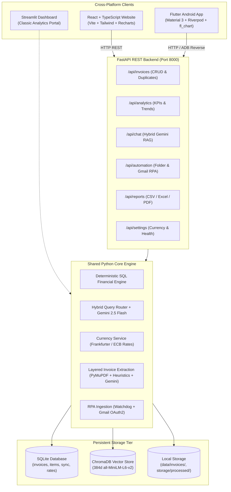

# Smart Invoice Processor — Full-Stack AI + RAG + RPA

> **Intelligent Enterprise Invoice Automation across Web, Mobile, and Python API powered by Google Gemini, ChromaDB, and SQLite**

[](https://github.com/placeholder/smart-invoice-processor/actions/workflows/tests.yml)
[](https://www.python.org/)
[](https://fastapi.tiangolo.com/)
[](https://react.dev/)
[](https://flutter.dev/)
[](https://streamlit.io/)
[](https://aistudio.google.com/)
[](https://www.trychroma.com/)
[](LICENSE)

An intelligent, cross-platform full-stack invoice processing application designed for finance teams, accountants, and engineers. The system combines:
1. **Shared FastAPI Backend (`api/`):** Unified REST API endpoints exposing core Python services with strict Decimal math calculations and rate-limited Gemini RAG orchestration.
2. **React + TypeScript Web Application (`web/`):** Modern Vite SPA with Tailwind CSS, Lucide icons, TanStack Query, and interactive Recharts data visualization.
3. **Flutter Android Application (`mobile_flutter/`):** Native Android app built with Material 3, Riverpod state management, GoRouter, Dio, and fl_chart, supporting real physical phone USB debugging.
4. **Streamlit Multi-Page Portal (`app.py`):** Standalone analytics and reporting dashboard for local exploration.
5. **Robotic Process Automation (RPA):** Background directory watchdog and Gmail inbox poller (OAuth 2.0 read-only).
6. **Dual-Model Storage:** SQLite relational database (WAL mode) + ChromaDB persistent vector database (Sentence Transformers `all-MiniLM-L6-v2`, 384d).

---

Table of Contents

- [System Architecture](#-system-architecture)
- [Client Platforms Overview](#-client-platforms-overview)
- [Technology Stack](#-technology-stack)
- [Installation & Quickstart](#-installation--quickstart)
  - [1. Backend & Python Setup](#1-backend--python-setup)
  - [2. React Web App Setup](#2-react-web-app-setup)
  - [3. Flutter Android App Setup](#3-flutter-android-app-setup)
  - [4. Streamlit Dashboard Setup](#4-streamlit-dashboard-setup)
- [Physical Android Device Testing (USB Debugging)](#-physical-android-device-testing-usb-debugging)
- [Deterministic Financial Safety (SQL vs. RAG)](#-deterministic-financial-safety-sql-vs-rag)
- [Multi-Currency Conversion & Valuation](#-multi-currency-conversion--valuation)
- [Automated Testing (108 Tests)](#-automated-testing-108-tests)
- [Security & Privacy](#-security--privacy)
- [License](#-license)

---

## System Architecture



---

## Client Platforms Overview

| Platform | Directory | Framework / Stack | Key Features |
|---|---|---|---|
| **FastAPI REST API** | `api/` | FastAPI, Uvicorn, Pydantic v2 | Unified JSON endpoints, streaming file exports, rate limiting, and CORS |
| **React Website** | `web/` | React 19, TypeScript, Vite, Tailwind CSS | Dark mode UI, KPI dashboard, drag-drop PDF uploader, Recharts, TanStack Query |
| **Flutter Mobile App** | `mobile_flutter/` | Flutter 3.19+, Riverpod, GoRouter, Dio | Android APK, physical USB debugging via ADB, camera/file upload, fl_chart |
| **Streamlit Portal** | `app.py`, `pages/` | Streamlit, Plotly, Pandas | Local multi-page analytics, interactive SQL query explorer, and ReportLab PDF downloads |

---

## Technology Stack

- **Backend & API:** Python 3.11+, FastAPI, Uvicorn, Pydantic v2, Python-Multipart.
- **AI & RAG:** Google Gemini API (`google-genai` SDK), Gemini 2.5 Flash, ChromaDB, Sentence Transformers (`all-MiniLM-L6-v2`, 384d).
- **Document Extraction:** PyMuPDF (`fitz`), Pillow, ReportLab, Pytesseract (optional fallback).
- **Database:** SQLite 3 (WAL mode, foreign keys, thread-safe connection pooling).
- **Frontend Web:** React 19, TypeScript, Vite 8, Tailwind CSS v4, Lucide React, Axios, TanStack React Query, Recharts.
- **Mobile:** Flutter 3, Material 3, Flutter Riverpod 2.5, GoRouter 14, Dio, File Picker, fl_chart, Intl.
- **RPA & Automation:** Google Workspace Gmail API v1, `google-auth-oauthlib`, Watchdog file monitor.
- **Currency Intelligence:** Frankfurter API v2 (European Central Bank reference rates), multi-tier SQLite caching.
- **Testing:** Pytest, Pytest-Asyncio, FastAPI TestClient, GitHub Actions CI.

---

##  Installation & Quickstart

### 1. Backend & Python Setup

```powershell
# 1. Clone repository
git clone <repository-url>
cd p1

# 2. Create and activate virtual environment
python -m venv .venv
.venv\Scripts\Activate.ps1
# On macOS/Linux: source .venv/bin/activate

# 3. Install Python dependencies
python -m pip install --upgrade pip
pip install -r requirements.txt

# 4. Configure environment
Copy-Item .env.example .env
# Edit .env and insert your free GEMINI_API_KEY from Google AI Studio

# 5. Generate sample demonstration invoices (12 fictional invoices across USD, EUR, GBP, INR)
python scripts/generate_sample_invoices.py

# 6. Launch FastAPI Backend
uvicorn api.main:app --host 0.0.0.0 --port 8000 --reload
```

- Interactive Swagger API Documentation: [http://127.0.0.1:8000/docs](http://127.0.0.1:8000/docs)
- API Health Status: [http://127.0.0.1:8000/api/health](http://127.0.0.1:8000/api/health)

---

### 2. React Web App Setup

```powershell
# In a new terminal window:
cd C:\gitrepo\p1\web

# Install npm packages
npm.cmd install

# Start development server
npm.cmd run dev
```

Open [http://localhost:5173](http://localhost:5173) in your browser.

To verify a production build:
```powershell
npm.cmd run build
```

---

### 3. Flutter Android App Setup

```powershell
# In a new terminal window:
cd C:\gitrepo\p1\mobile_flutter

# Fetch Flutter dependencies
flutter pub get

# Run on connected Android device (or emulator)
flutter run --dart-define=API_BASE_URL=http://127.0.0.1:8000/api
```

---

### 4. Streamlit Dashboard Setup

```powershell
# In your virtual environment:
streamlit run app.py
```

Open [http://localhost:8501](http://localhost:8501) in your browser.

---

## 📱 Physical Android Device Testing (USB Debugging)

To run and test the Flutter app directly on a **real physical Android phone** connected to your Windows laptop:

1. Enable **Developer Options** and **USB Debugging** on your phone (Settings -> About Phone -> tap Build Number 7 times -> Developer Options -> USB Debugging).
2. Connect your phone to your laptop using a USB data cable and accept the RSA prompt.
3. Set up **ADB Reverse Port Forwarding** so your phone can reach FastAPI directly via `127.0.0.1:8000`:
   ```powershell
   adb reverse tcp:8000 tcp:8000
   ```
4. Run the Flutter app:
   ```powershell
   cd mobile_flutter
   flutter run --dart-define=API_BASE_URL=http://127.0.0.1:8000/api
   ```

For detailed physical device setup, Wi-Fi LAN testing instructions, and a 12-point device testing checklist, see [**docs/ANDROID_TESTING.md**](docs/ANDROID_TESTING.md).

---

##  Deterministic Financial Safety (SQL vs. RAG)

| Query Type | Routing Path | Engine | Accuracy Guarantee |
|---|---|---|---|
| **Spending Totals & Counts** | Category A | SQLite SQL Engine | **100% Deterministic (Zero Hallucination)** |
| **Vendor Comparisons** | Category A | SQLite SQL Engine | **100% Deterministic** |
| **Currency Conversion** | Category A / C | Python `Decimal` + ECB Rates | **Exact Cent / Paisa Precision** |
| **Service Explanations** | Category B | ChromaDB + Gemini 2.5 Flash | **Grounded in Verified Citations** |
| **Hybrid Syntheses** | Category C | SQL Engine + ChromaDB + Gemini | **Verified Math + Contextual Summary** |

---

##  Multi-Currency Conversion & Valuation

- **Supported Currencies:** USD ($), EUR (€), GBP (£), and INR (₹).
- **Valuation Modes:**
  - *Historical:* Converts using reference rates on the specific date of each invoice.
  - *Latest:* Converts using current ECB reference rates from Frankfurter API.
- **Deduplication Safety:** Flagged duplicate invoices are strictly excluded from aggregated financial spending totals.

---

##  Automated Testing (108 Tests)

The repository features an automated test suite with **108 passing tests** covering the entire full-stack pipeline:

```powershell
pytest -v
```

```
============================ 108 passed in 20.30s =============================
```

**Subsystem Test Breakdown:**
- `tests/test_api.py` (17 tests): Health check, system diagnostics, invoice CRUD, duplicate listing, currency preferences, analytics endpoints, chat query router, file export downloads.
- `tests/test_currency_service.py` (14 tests): Multi-currency conversion, historical rate lookups, decimal precision, duplicate spending exclusion, and INR formatting.
- `tests/test_gmail_automation.py` (14 tests): OAuth token loading, MIME attachment parsing, duplicate skipping, and background worker lifecycle.
- `tests/test_report_service.py` (7 tests): Report data aggregation, CSV exports, Excel (.xlsx) formatting, and ReportLab PDF rendering.
- `tests/test_invoice_parser.py` (4 tests): Multi-layered extraction, Level 3 Gemini JSON fallback, and math consistency checks.
- `tests/test_duplicate_detection.py` (6 tests): SHA-256 cryptographic detection, logical business duplicate detection, and manual review audit states.
- `tests/test_rag_pipeline.py` (5 tests): Hybrid query classification, RAG retrieval, citation metadata, and offline fallbacks.
- `tests/test_formatting.py` (8 tests): Markdown dollar-sign escape preservation, currency symbol handling, and AWS invoice separation.
- `tests/test_database.py` (4 tests): SQLite table initialization, multi-currency storage, and transaction safety.
- `tests/test_vector_store.py` (3 tests): ChromaDB indexing, embedding search, idempotent reindexing, and chunk deletion.
- `tests/test_pdf_extractor.py` (5 tests): PyMuPDF text stream parsing and corrupt file handling.
- `tests/test_queries.py` (5 tests): Deterministic financial queries.
- `tests/test_query_router.py` (3 tests): Question classification into SQL, RAG, and Hybrid categories.
- `tests/test_gemini_service.py` (6 tests): Model fallback, quota handling, and API key protection.

---

##  Security & Privacy

- **Zero Secret Exposure:** `.env`, OAuth tokens, credentials, and logs are excluded via `.gitignore`.
- **Read-Only Scope:** Gmail integration requests strictly read-only access (`gmail.readonly`).
- **No Inadvertent Deletes:** Deduplication flags duplicate candidates for review without deleting audit history.
- **Local Storage:** ChromaDB vectors and SQLite database reside entirely on local disk.

---

##  License

This project is open-source and licensed under the terms of the [MIT License](LICENSE).
