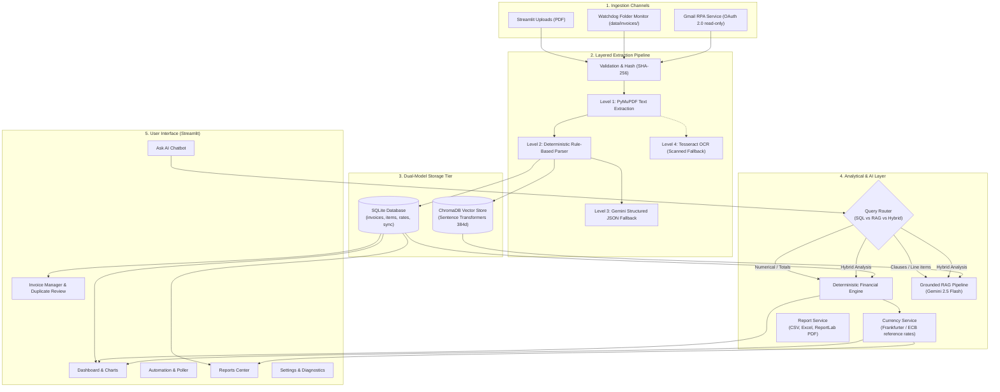
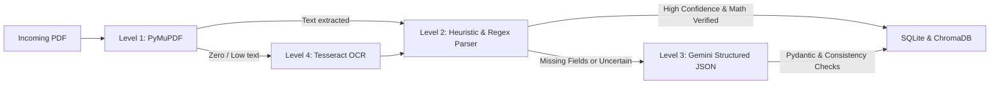
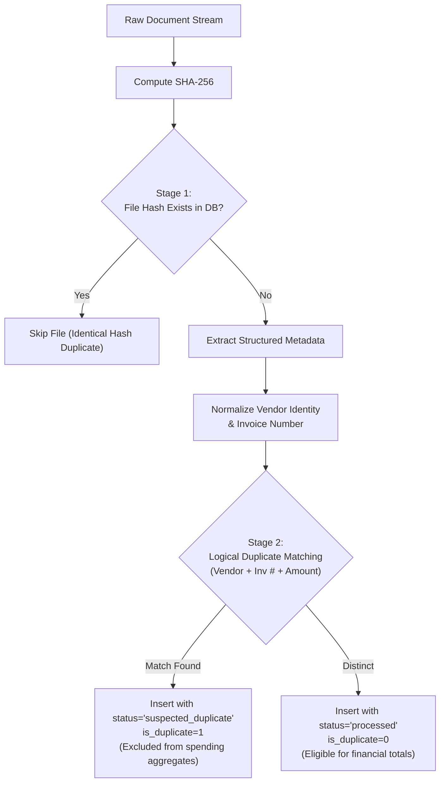
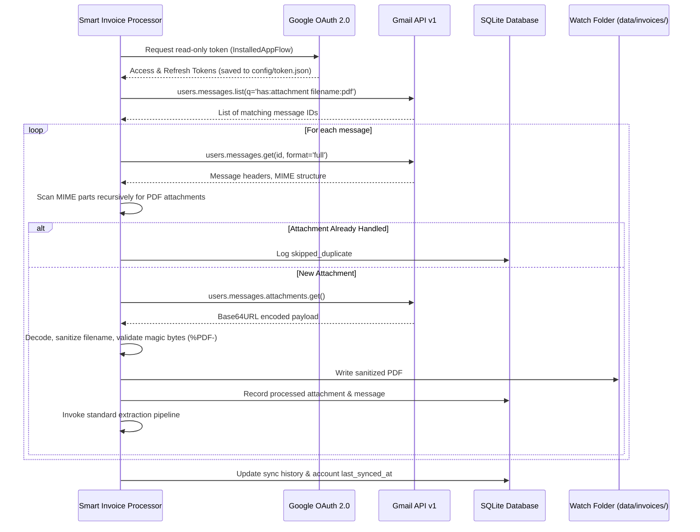
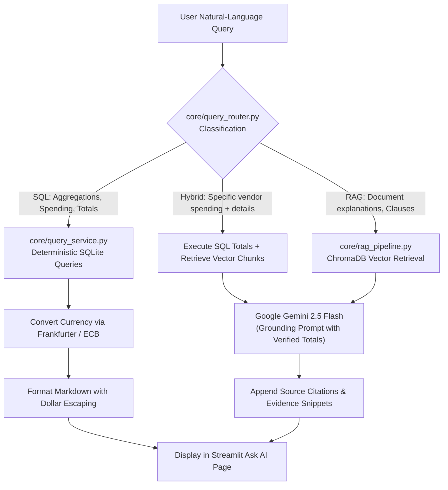
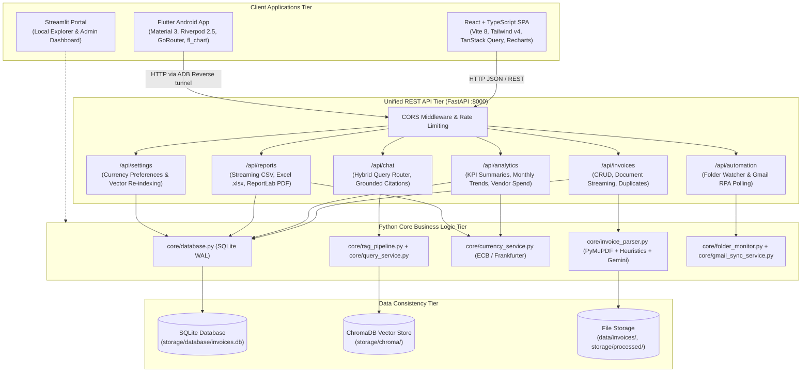

# Smart Invoice Processor — System Architecture & Design

This document details the architectural blueprints, technical data flows, database models, and design patterns utilized in the **Smart Invoice Processor**.

---

## 1. High-Level System Architecture

The application combines **Robotic Process Automation (RPA)**, **Deterministic Financial Modeling (SQL + Decimal)**, **Persistent Vector Retrieval (ChromaDB)**, and **Large Language Model Grounding (Google Gemini API)** within a unified multi-page Streamlit application.



---

## 2. Ingestion & Pre-Processing Pipeline

The application supports three ingestion entry points:

1. **Direct UI Upload:** User drags and drops PDF files into `pages/2_Upload_Invoices.py`.
2. **Watchdog Folder Monitor:** `core/folder_monitor.py` tracks changes in `data/invoices/` using system file events, running autonomously in a daemon thread.
3. **Gmail RPA Inbox Automation:** `core/gmail_sync_service.py` searches Gmail for supplier invoices using the Gmail API v1 with read-only scopes.

### Pre-Processing Workflow:
- **File Validation:** Validates file size ($\le 20\text{ MB}$ by default) and magic bytes (`%PDF-`).
- **Cryptographic Hashing:** Computes SHA-256 checksum over the raw bytes.
- **Stage 1 Hash Deduplication:** If the identical SHA-256 hash already exists in SQLite, ingestion skips reprocessing to ensure idempotency.

---

## 3. Layered PDF Extraction Strategy



1. **Level 1 — Native PDF Extraction (PyMuPDF):** Extracts clean page-by-page text streams and document metadata.
2. **Level 2 — Deterministic Rule-Based Parser:** Employs regex patterns and known vendor dictionaries to extract invoice numbers, vendor names, issue dates, due dates, currencies, line items, and financial amounts.
3. **Level 3 — Optional Gemini AI Structured Extraction:** When rule-based heuristics produce uncertain or missing fields, the system can consult Google Gemini with a strict JSON schema validated via Pydantic.
   - **Financial Consistency Constraint:** $Subtotal + Tax - Discount \approx Total$. If arithmetic consistency fails, the document is flagged for manual human review.
4. **Level 4 — Optional Scanned OCR (Tesseract):** For image-only PDFs, falls back to local Tesseract OCR if installed, without blocking ordinary text-based invoice workflows.

---

## 4. Two-Tier Duplicate Prevention Architecture



- **Stage 1 — Identical File Protection:** Protects against re-uploading the exact same PDF bytes.
- **Stage 2 — Logical Business Invoice Protection:** Prevents duplicate accounting entries when the same invoice is re-exported, scanned with a different scanner, or sent multiple times under different filenames. Records are **never deleted automatically**, preserving an auditable history in SQLite while safeguarding aggregate spending calculations.

---

## 5. Gmail RPA Inbox Automation Workflow



---

## 6. ChromaDB Vector Store & Embedding Architecture

- **Embedding Model:** `sentence-transformers/all-MiniLM-L6-v2` produces dense 384-dimensional semantic vectors.
- **Document Chunking:** `core/document_chunker.py` segments each invoice into:
  - **Summary Chunk:** High-level metadata (vendor, dates, totals, customer, payment status).
  - **Line Item Chunks:** Distinct service or product line descriptions.
  - **Contextual Chunk:** Page-level text blocks for narrative terms and conditions.
- **Vector Database:** Persistent on-disk ChromaDB collection (`storage/chroma/`). Supports metadata filtering by invoice ID, vendor, and document hash.

---

## 7. Deterministic Query Routing & RAG Pipeline



### Deterministic Financial Safety Rule:
**Large Language Models are never allowed to perform independent financial arithmetic.**
All mathematical totals, expense comparisons, and invoice counts originate strictly from deterministic SQLite queries and Decimal-based currency conversions. The LLM is used exclusively for natural-language synthesis, explanations, and summarization grounded in verified facts.

---

## 8. Multi-Currency Conversion Architecture

- **API Provider:** Frankfurter API v2 (`api.frankfurter.dev`).
- **Reference Rates:** European Central Bank (ECB) daily reference rates.
- **Conversion Math:** Python `Decimal` with `ROUND_HALF_UP` to two decimal places.
- **Supported Currencies:** USD, EUR, GBP, and INR.
- **Two-Tier Caching:**
  - Fast in-memory dictionary cache.
  - Persistent SQLite table `exchange_rate_cache`.
- **Historical vs. Latest Modes:** Invoices can be valued using either historical rates on their issue dates or the latest available market rates.

---

## 9. Reporting Service Architecture

`core/report_service.py` provides certified report generation across 4 core business domains:
1. **Invoice Summary Report:** Comprehensive record register with original and converted valuations.
2. **Monthly Expense Report:** Month-by-month spending trends converted to reference currency.
3. **Vendor Spending Report:** Supplier expenditure breakdowns alongside excluded duplicate values.
4. **Duplicate Review Report:** Audit register of suspected and confirmed duplicates.

**Output Engines:**
- **CSV:** UTF-8 encoded comma-separated values.
- **Excel:** OpenPyXL multi-sheet workbooks (`.xlsx`).
- **PDF:** ReportLab document flow with table styles, alternating row backgrounds, and landscape pagination.


---

## 10. Multi-Client Full-Stack Architecture

To provide enterprise-grade access across desktop and mobile form factors, the Smart Invoice Processor implements a unified multi-tier architecture:



### Shared Data Consistency & Cross-Platform Integrity
1. **Single Source of Truth:** All clients (React website, Flutter Android app, and Streamlit) connect to the exact same backend SQLite database and ChromaDB vector store.
2. **Deterministic Calculations:** All financial metrics and aggregations are computed exclusively on the backend in Python using exact `Decimal` precision; clients never calculate arithmetic locally.
3. **Audit Safety:** Invoices marked as duplicates or verified on mobile immediately reflect on the web dashboard and Streamlit portal without synchronization delay.

---

## 11. Physical Device Mobile Debugging Architecture

For real-world testing on a physical Android smartphone connected via USB:

```
[ Physical Android Phone ]
       |
  (Flutter App)
       |
  http://127.0.0.1:8000
       |
[ USB Cable (ADB) ]
  adb reverse tcp:8000 tcp:8000
       |
[ Windows Laptop ]
  FastAPI Server (0.0.0.0:8000)
       |
  SQLite & ChromaDB
```

1. **ADB Reverse Tunnel:** `adb reverse tcp:8000 tcp:8000` routes port 8000 on the Android device back through the USB cable to port 8000 on the Windows laptop.
2. **Cleartext Traffic Policy:** `android:usesCleartextTraffic="true"` is enabled in Android debug configuration to permit HTTP development traffic over the local loopback.
3. **Dynamic Base URL:** The Flutter app includes a runtime URL configurator in its Settings screen, supporting zero-rebuild switching between USB ADB reverse (`http://127.0.0.1:8000/api`) and Wi-Fi LAN IP (`http://192.168.x.x:8000/api`).
